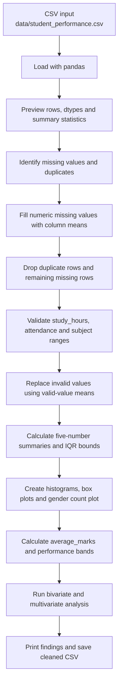

# 📊 Student Performance EDA

> Explore how study habits and attendance relate to student marks through data cleaning, visualizations, and descriptive analysis.


---

## 🧭 Contents

- [Project overview](#-project-overview)
- [Quick start](#-quick-start)
- [Analysis workflow](#-analysis-workflow)
- [Step-by-step code and mathematics](#step-by-step-code-and-mathematics)
- [Performance bands](#-performance-bands)
- [Verified run summary](#-verified-run-summary)
- [Output](#-output)
- [Interpretation note](#-interpretation-note)

## 🔎 Project overview

This project analyzes a small student dataset containing study hours, attendance, gender, and marks in math, science, and English.

| File | Purpose |
| --- | --- |
| [`student_performance.py`](student_performance.py) | Runs the EDA workflow |
| [`data/student_performance.csv`](data/student_performance.csv) | Input dataset |
| [`requirements.txt`](requirements.txt) | Python dependencies |

## 🚀 Quick start

### 1. Create a virtual environment

```bash
python3 -m venv .venv
```

Activate it:

```bash
# macOS / Linux
source .venv/bin/activate
```

```powershell
# Windows PowerShell
.venv\Scripts\Activate.ps1
```

### 2. Install dependencies

```bash
python -m pip install -r requirements.txt
```

### 3. Run the analysis

Run this from the project directory:

```bash
python student_performance.py
```

The script opens charts in plot windows. Close each window to continue.

## 🧪 Analysis workflow



### Step-by-step code and mathematics

#### 1. Load the dataset

`Path(__file__).parent / "data" / "student_performance.csv"` creates a path relative to the Python file. `pd.read_csv()` loads the data into a pandas `DataFrame`.

Numeric columns are selected with `select_dtypes(include=[np.number])`. `student_id` is then excluded because it is an identifier, not a measured feature.

#### 2. Inspect the data

The script prints:

- The first five rows.
- `describe()` statistics for numeric features.
- Column data types.
- Missing-value counts.
- Missing-value percentages.
- Duplicate-row counts.
- Unique values per column.

For a column containing $n$ observations, the missing-value percentage is:

$$
\text{Missing\%}_j =
\frac{\text{number of missing values in column }j}{n} \times 100
$$

The duplicate count is the number of rows for which `df.duplicated()` is `True` (only rows duplicated after their first occurrence are counted).

#### 3. Handle missing values

Missing values in each numeric feature are filled with that feature's mean:

$$
\bar{x}_j=\frac{1}{n_j}\sum_{i=1}^{n_j}x_{ij}
$$

where $n_j$ is the number of non-missing observations in column $j$. Pandas computes this mean using the valid values and then replaces missing entries in the same column.

The script then removes duplicates and any remaining rows containing missing values:

```python
df_cleaned = df.drop_duplicates().dropna()
```

#### 4. Validate allowed ranges

The allowed ranges are:

| Column | Minimum | Maximum |
| --- | ---: | ---: |
| `study_hours` | 0 | 24 |
| `attendance` | 0 | 100 |
| `math` | 0 | 100 |
| `science` | 0 | 100 |
| `english` | 0 | 100 |

A value is invalid when:

$$
x_i < \text{minimum} \quad \text{or} \quad x_i > \text{maximum}
$$

For each invalid column, the script first keeps only valid values and calculates their mean:

$$
\bar{x}_{j,\text{valid}} =
\frac{\sum_{i=1}^{n_j}x_{ij}\mathbf{1}(min_j \le x_{ij} \le max_j)}
{\sum_{i=1}^{n_j}\mathbf{1}(min_j \le x_{ij} \le max_j)}
$$

Here, $\mathbf{1}(\cdot)$ equals 1 when the condition is true and 0 otherwise. Invalid values are replaced with this mean. Subject-mark means are rounded to a whole number using:

$$
\text{replacement}=\left\lfloor \bar{x}_{j,\text{valid}}+0.5 \right\rfloor
$$

#### 5. Calculate five-number summaries

For every numeric feature except `student_id`, the script calculates:

1. Minimum
2. First quartile, $Q1$
3. Median, $Q2$
4. Third quartile, $Q3$
5. Maximum

The interquartile range is:

$$
IQR=Q3-Q1
$$

The script uses the standard $1.5\times IQR$ rule:

$$
\text{Lower bound}=Q1-1.5(IQR)
$$

$$
\text{Upper bound}=Q3+1.5(IQR)
$$

An observation is counted as an outlier when:

$$
x_i<\text{Lower bound} \quad \text{or} \quad x_i>\text{Upper bound}
$$

For the current 10-row dataset, no study-habit or subject-mark outliers are detected after range cleaning.

#### 6. Produce univariate plots

- Histograms show the distribution of `study_hours`, `attendance`, `math`, `science`, and `english`.
- Box plots show medians and quartiles and provide a visual check for outliers.
- `countplot` shows the number of male and female students.

#### 7. Calculate average marks and performance bands

The average for student $i$ is the arithmetic mean of the three subject marks:

$$
\text{Average}_i=
\frac{\text{math}_i+\text{science}_i+\text{english}_i}{3}
$$

The performance label is assigned using non-overlapping, left-inclusive intervals:

| `average_marks` | Category |
| --- | --- |
| $<70$ | Needs Improvement |
| $70\le x<80$ | Average |
| $80\le x<90$ | Good |
| $x\ge90$ | Excellent |

### `average_marks` and `performance` feature engineering

This section creates two derived features from the three subject columns:

- `average_marks` is a **continuous numerical feature**.
- `performance` is a **categorical feature** derived from `average_marks`.

```python
mark_columns = ["math", "science", "english"]
df_cleaned["average_marks"] = df_cleaned[mark_columns].mean(axis=1)

df_cleaned["performance"] = pd.cut(
    df_cleaned["average_marks"],
    bins=[-np.inf, 70, 80, 90, np.inf],
    labels=["Needs Improvement", "Average", "Good", "Excellent"],
    right=False,
)
```

`axis=1` means pandas calculates the mean across columns, rather than across rows. For student $i$, the exact expression is:

$$
\text{average\_marks}_i =
\frac{\text{math}_i+\text{science}_i+\text{english}_i}{3}
$$

The output is not necessarily an integer because dividing a sum by 3 can produce a fraction.

#### Performance interval formula

Let $x$ represent a student's `average_marks`. `pandas.cut()` with `right=False` applies:

$$
\text{performance}(x)=
\begin{cases}
\text{Needs Improvement}, & -\infty \le x < 70 \\
\text{Average}, & 70 \le x < 80 \\
\text{Good}, & 80 \le x < 90 \\
\text{Excellent}, & 90 \le x < \infty
\end{cases}
$$

The boundaries are deliberately non-overlapping:

$$
[-\infty,70),\quad [70,80),\quad [80,90),\quad [90,\infty)
$$

This means that a value of exactly 70 belongs to `Average`, exactly 80 belongs to `Good`, and exactly 90 belongs to `Excellent`. `-np.inf` and `np.inf` ensure that every real average can be assigned a category.

#### Example calculations

For Rahul:

$$
\text{average\_marks}
=\frac{65+70+75}{3}
=70.0
$$

Because $70 \le 70.0 < 80$, Rahul is labeled `Average`.

For Pooja:

$$
\text{average\_marks}
=\frac{95+98+96}{3}
=96.333\ldots
\approx96.3
$$

Because $96.3 \ge 90$, Pooja is labeled `Excellent`.

For Amit, after the invalid `math=-40` and `english=103` values are cleaned:

$$
\text{average\_marks}
=\frac{82+58+88}{3}
=76.0
$$

This places Amit in the `Average` category.

#### Feature-engineering purpose

Feature engineering transforms or combines raw variables into more meaningful columns for analysis:

```text
Raw features:
math, science, english
          |
          | arithmetic mean
          v
Derived feature:
average_marks
          |
          | fixed thresholds
          v
Derived category:
performance
```

`average_marks` reduces three subject scores into one overall academic-performance value, making comparisons with `study_hours`, `attendance`, and `gender` easier.

`performance` converts continuous marks into four ordered descriptive categories. It is useful for category counts and comparisons, but converting continuous values to categories loses the original detail:

```text
87.2, 85.0, 89.9  ->  all become "Good"
```

Therefore, the script also retains `average_marks`; it does not replace the continuous value with the category.

#### Category count formula

The count for category $c$ is:

$$
\text{Count}(c)=
\sum_{i=1}^{n}\mathbf{1}(\text{performance}_i=c)
$$

where $\mathbf{1}(\cdot)$ is 1 when the condition is true and 0 otherwise.

The printed count table uses `value_counts(sort=False)`, so it preserves category order:

| Category | Count |
| --- | ---: |
| Needs Improvement | 0 |
| Average | 4 |
| Good | 2 |
| Excellent | 4 |

#### 8. Perform bivariate analysis

The script creates:

- A scatter plot of study hours against average marks.
- A scatter plot of attendance against average marks.
- A box plot comparing average marks by gender.
- A correlation table for study hours, attendance, and average marks.

Pearson's correlation coefficient between columns $x$ and $y$ is:

$$
r_{xy}=
\frac{\sum_{i=1}^{n}(x_i-\bar{x})(y_i-\bar{y})}
{\sqrt{\sum_{i=1}^{n}(x_i-\bar{x})^2}
\sqrt{\sum_{i=1}^{n}(y_i-\bar{y})^2}}
$$

The value ranges from $-1$ to $1$:

- $r>0$: positive linear relationship.
- $r<0$: negative linear relationship.
- $r=0$: no linear relationship in the sample.

It does not measure causation or every possible nonlinear relationship.

#### 9. Perform multivariate analysis

The script calculates correlations among `study_hours`, `attendance`, `math`, `science`, and `english`, then displays the matrix as a heatmap. The heatmap uses the same Pearson formula for every pair of features. Its color scale is fixed from $-1$ to $1$.

#### 10. Print descriptive findings

The script prints:

- Number of cleaned students.
- Overall mean average marks.
- Highest- and lowest-scoring students.
- Mean average marks by gender.
- Pearson correlations for study hours and attendance with average marks.

The overall mean is:

$$
\overline{\text{Average}}=
\frac{1}{n}\sum_{i=1}^{n}\text{Average}_i
$$

The identifier `student_id` is not used as a measured numeric feature.

## ✅ Verified run summary

Running the script against the included 10-row dataset produced:

| Result | Value |
| --- | --- |
| Cleaned students | 10 |
| Overall average marks | 83.5 |
| Highest average | Pooja, 96.3 |
| Lowest average | Rahul, 70.0 |
| Female average marks | 92.7 |
| Male average marks | 74.2 |
| Study hours correlation with average marks | 0.94 |
| Attendance correlation with average marks | 0.94 |
| IQR outliers after cleaning | 0 for all measured features |

These values are descriptive and apply only to this sample.

## 🏅 Performance bands

The `performance` category is derived from each student's average across math, science, and English:

| Average marks | Category |
| ---: | :--- |
| `< 70` | Needs Improvement |
| `70–<80` | Average |
| `80–<90` | Good |
| `≥ 90` | Excellent |

These are project-defined cutoffs, not universal grading standards. `average_marks` may be fractional; individual subject marks remain whole numbers.

## 📁 Output

After a successful run, the cleaned dataset is written to:

```text
data/processed/student_performance_eda_cleaned.csv
```

The output includes the input columns plus `average_marks` and `performance`. The processed directory is created automatically if needed.

## ⚠️ Interpretation note

The sample contains only **10 students**. Use charts and correlations as exploratory descriptions; they do not establish that study hours or attendance cause higher marks.
